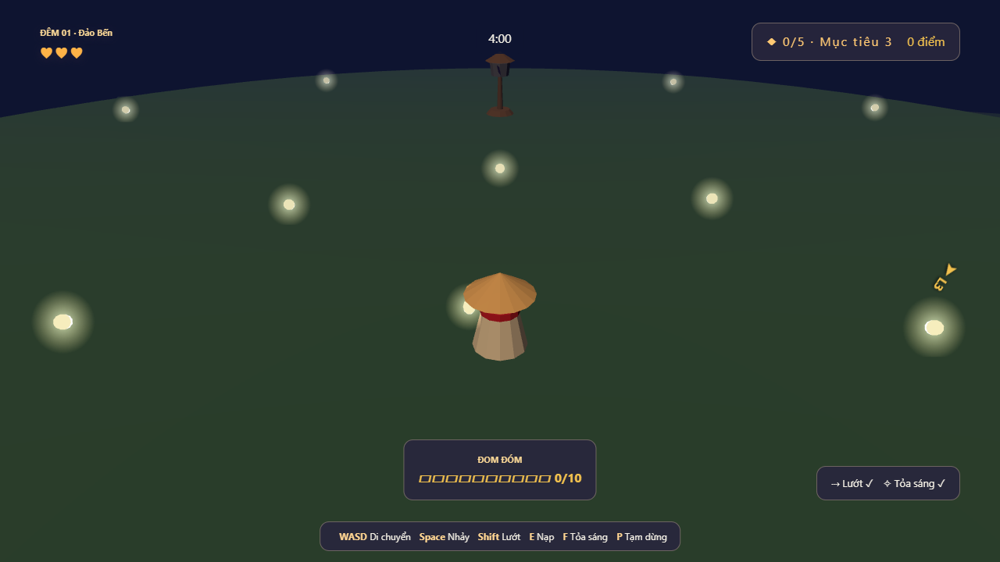

# Đảo Đèn Lồng · Ba hòn đảo

Cùng Mây thắp đèn trên Đảo Bến, vượt cầu tre của Đảo Cau rồi leo tháp ở Đảo Chuông trước bình minh. Game web dùng Three.js, Node 22 và Test Contract v1.2.



### Cài và chơi

Từ gốc repo trên macOS/Linux hoặc Windows:

```sh
npm ci
npm run dev
```

**WASD** di chuyển, **Space** nhảy, **Shift** lướt, **E** nạp đèn, **F** tỏa sáng. Kéo chuột hoặc dùng **Q/R** xoay camera. **P/Esc** tạm dừng. Từ menu chọn Bắt đầu, đọc lời Ông Đăng và chọn Vào đảo. Cài đặt âm lượng và độ nhạy được lưu trên trình duyệt.

**Mục tiêu:** giữ Mây còn lửa đến bình minh và giữ sáng ít nhất 3/5 đèn ở Đảo Bến, 4/6 ở Đảo Cau, 5/7 ở Đảo Chuông. Ba đêm lần lượt dài 240, 270 và 300 giây.

Nhấn **E** để nạp đèn tắt hoặc châm dầu cho đèn sáng. Lần đầu cần 10 đốm, thắp lại cần 5. Đèn mới thắp có 100 dầu, hao 1 mỗi giây. Một đốm châm thêm 10 dầu. Dưới 30 dầu, đèn nhấp nháy và mất vòng bảo vệ 6 m. Bóng Mực hút thêm 5 dầu mỗi giây mỗi con. Túi bắt đầu ở 10, tăng 2 mỗi lần thắp thành công, tối đa 20. Trong Cài đặt có **Bảng màu dễ phân biệt**, được lưu giữa các lần mở game.

**Điểm:** mỗi đốm nạp +5, thắp lần đầu +100, thắp lại +40. Mỗi Bóng Mực trúng tỏa sáng +5, hoặc +15 nếu nó đang hút dầu. Khi thắng, mỗi đèn sáng được +50 cộng phần nguyên lượng dầu còn lại, mỗi ngọn lửa còn lại +50. Tổng điểm chỉ cộng các đêm thắng.

### Kiểm thử

```sh
npm test
node src/headless.js --seed 73 --night 1 --scenario tests/oil-dawn.json --inputs tests/oil-inputs.json --ticks 65 --snapshot-every 1 --out result.jsonl
```

CLI nhận Đêm 1–3. Scenario trên kiểm tra đèn tắt và thắp lại ở tick 1, thắng lúc bình minh ở tick 2 với 662 điểm. Trên Linux/macOS chạy `sh scripts/verify-phase3.sh` để tái tạo bộ bằng chứng headless. `npm run build` tạo bản web tĩnh ở `dist/`.

[Contract](game.contract.json) · [Quyết định Phase 3](docs/notes/phase-3.md) · [Changelog](CHANGELOG.md) · [Bằng chứng Phase 3](docs/proof/phase-3/) · [Nguồn tài sản](CREDITS.md)

### Sáng tạo của tôi

Quầng đom đóm và chiếc đèn treo bên nón lá được dựng thủ tục. Renderer đọc trạng thái từ cùng lõi với CLI. Ảnh trên và bộ test tái lập cùng seed là bằng chứng tương ứng.

## Tài liệu gốc của lab

> **Cá nhân** (1 người / 1 MSSV) · Áp dụng SDLC cùng AI để xây một **game 3D** qua **4 phase**, từ yêu cầu ban đầu tới bản phát hành.
> **Lab board + trợ giảng:** **[Đảo Đèn Lồng Lab](https://claude.ai/artifact/Q1RYyv1dxjUczzCbd2ZnoW)**

---

## Tài liệu của lab

| File | Nội dung |
|---|---|
| [GUIDE.md](GUIDE.md) | Hướng dẫn làm lab: vòng làm việc mỗi phase, harness, kiểm chứng, token |
| [CHECKPOINTS.md](CHECKPOINTS.md) | Các mốc tự kiểm tra từ chuẩn bị đến nộp bài |
| [SUBMISSION.md](SUBMISSION.md) | Đặt tên repo, hạn nộp, tag, Release, video, checklist |
| [RULES.md](RULES.md) | Quy định: AI, trung thực về bằng chứng, bản quyền, bảo mật |
| [RUBRIC.md](RUBRIC.md) | Thang điểm chi tiết |

## Lab board

Yêu cầu dự án được phát hành tại **[Đảo Đèn Lồng Lab](https://claude.ai/artifact/Q1RYyv1dxjUczzCbd2ZnoW)**. Mỗi phase là một tab (tab chưa phát hành bị khóa), mỗi tab có trợ giảng AI riêng chỉ trả lời trong phạm vi phase đó. Trợ giảng cần đăng nhập claude.ai và dùng lượt Claude của bạn.

## Dự án

**Đảo Đèn Lồng**: game 3D góc nhìn thứ ba. Mây, người giữ đèn nhỏ tuổi, gom đom đóm để thắp lại các Đèn Lồng Lớn và né Bóng Mực trong sương đen.

- Không ràng buộc công nghệ; chạy được trên macOS hoặc Linux.
- Tuân theo **Test Contract** (chế độ headless) để được chấm tự động và so sánh với nhau.

| Phase | Bạn nhận | Nộp |
|---|---|---|
| 1 | **PRD-0** (mô tả tổng quát) + Test Contract | tag `phase-1` |
| 2 | **Ticket-02**, phát hành khi Phase 1 kết thúc | tag `phase-2` |
| 3 | **Ticket-03**, phát hành khi Phase 2 kết thúc | tag `phase-3` |
| 4 | **Ticket-04**, phát hành khi Phase 3 kết thúc | tag `phase-4` + Release `v1.0.0` |

Yêu cầu sẽ được bổ sung và có thể thay đổi giữa các phase, giống dự án thật.

### Lịch 4 giờ

Bài lab kéo dài **4 giờ**. Phase 1 và 2 khoảng **1 giờ**, Phase 3 khoảng **30 phút**, Phase 4 khoảng **1 giờ 30 phút**. Mỗi phase phát hành đúng mốc giờ. Phase mới xuất hiện trên lab board khi tới mốc.

| Mốc | Sự kiện | Hạn tag |
|---|---|---|
| 0h | Phát hành **Phase 1** (PRD-0), gồm cả phần chuẩn bị | `phase-1` trước mốc 1h |
| 1h | Phát hành **Phase 2** | `phase-2` trước mốc 2h |
| 2h | Phát hành **Phase 3** | `phase-3` trước mốc 2h30 |
| 2h30 | Phát hành **Phase 4** | `phase-4`, Release `v1.0.0` và video trước mốc 4h |
| 4h | Hết giờ lab, chốt bài | |

Hết giờ mỗi phase thì tag và chuyển sang phase tiếp theo, dù phase chưa hoàn hảo. Chỗ chưa xong ghi trung thực trong bằng chứng.

---

## Gợi ý SDLC (cách làm là của bạn)

Mỗi phase là một vòng nhỏ. Công cụ, thứ tự, định dạng tài liệu đều tự do; đây chỉ là gợi ý:

1. **Requirements:** biến yêu cầu thành tiêu chí nghiệm thu kiểm chứng được. Chỗ mơ hồ thì tự giả định và ghi lại.
2. **Plan:** nghĩ cách kiểm chứng **trước** khi để agent viết code.
3. **Build:** để agent viết, bạn điều phối và review.
4. **Verify:** chạy thật, kiểm tra hành vi thật. *Không có bằng chứng thì chưa xong*: "agent bảo chạy rồi" không phải bằng chứng.
5. **Evaluate:** cái gì đạt, AI sai ở đâu, harness (AGENTS.md, skill, hook) cần chỉnh gì.
6. **Release:** gắn tag.

## Ba điều cần nhớ

> Bạn được **tự do sáng tạo thêm** quanh phần lõi (nhân vật mới, kẻ địch mới, cơ chế nhỏ, câu chuyện, hiệu ứng, âm thanh…). Sáng tạo gọn và không phá yêu cầu được tính điểm trong hạng mục F của [RUBRIC](RUBRIC.md); ghi mục "Sáng tạo của tôi" trong README của bạn.

- **Game tốt là game đúng yêu cầu của khách hàng**, không phải game phức tạp hay đẹp nhất. Làm đúng và chứng minh được là đúng trước, trau chuốt sau.
- **Cân nhắc kỹ quota token của bạn.** Đốt nhiều token không làm bài tốt hơn. Ngữ cảnh gọn, kế hoạch rõ, kiểm chứng sớm thường vừa rẻ vừa đúng hơn chạy agent liên tục.
- **Kiểm chứng là phần quan trọng nhất.** Bằng chứng (test, output headless, ảnh, số đo) đáng giá hơn lời mô tả.

---

## Bàn giao cuối cùng

Một **repo GitHub cá nhân, public**, gồm:

1. **Toàn bộ mã nguồn** của game qua 4 phase, tag `phase-1` … `phase-4`, Release `v1.0.0`.
2. **Video demo `.mp4` dưới 5 phút** (đính kèm Release `v1.0.0` hoặc `docs/demo/demo.mp4`, link ở đầu README): chơi thử và cho thấy bằng chứng game chạy đúng.
3. **Bằng chứng kiểm chứng** của từng phase (định dạng tự chọn).
4. **Harness AI đã dùng** (AGENTS.md / CLAUDE.md, skills, hooks, plugins…), giữ nguyên trong repo và lịch sử git.
5. **Ghi chép ngắn:** spec/giả định mỗi phase, nhật ký dùng AI (gồm token/chi phí ước tính), retro.

Không commit API key, token hay `.env`. Gửi link repo theo hướng dẫn của Coach.

## Đánh giá (100 điểm)

| Hạng mục | Điểm |
|---|---|
| Test tự động ẩn (headless, gồm kiểm tra lại phase trước) | 30 |
| Kiểm chứng & bằng chứng của bạn | 20 |
| Quy trình SDLC & harness AI | 15 |
| Evaluation & retro (gồm cách bạn dùng token) | 10 |
| Hiệu năng & ổn định | 10 |
| Chất lượng sản phẩm (đúng yêu cầu, chơi được) | 10 |
| Video demo | 5 |

## Quy định

- Dùng AI thoải mái; không sao chép repo của người khác.
- Bằng chứng phải thật: test luôn đạt hay output sửa tay là vi phạm.
- Nhân vật, bối cảnh là bản gốc của lab; asset bên ngoài chỉ dùng loại CC0/CC-BY/MIT hoặc tự tạo, ghi nguồn trong `CREDITS.md`.
